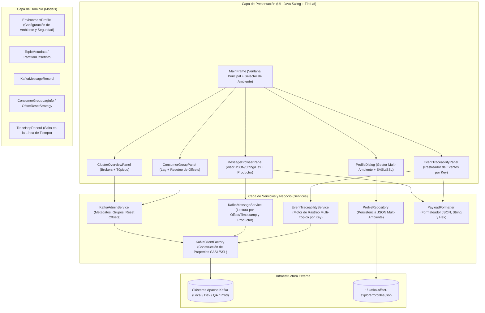
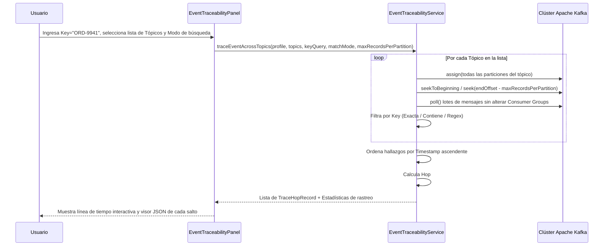

# Arquitectura del Proyecto — Kafka Offset Explorer & Event Tracer

## 1. Visión General de la Arquitectura
La aplicación sigue una **Arquitectura en Capas (Layered Architecture)** desacoplada con el patrón **Model-View-Service (MVS)** adaptada para aplicaciones de escritorio ricas en Java Swing:



---

## 2. Estructura de Paquetes y Módulos

```text
C:\Users\prueb\Downloads\offsetexplorer
├── pom.xml                                  # Configuración Maven (Java 17, kafka-clients, Jackson, FlatLaf)
├── requirements.md                          # Especificación de requerimientos funcionales y no funcionales
├── ARCHITECTURE.md                          # Documento de arquitectura del sistema
├── README.md                                # Guía paso a paso de compilación y ejecución
├── build-windows-exe.ps1                    # Script automatizado para compilar y generar el .exe con jpackage
├── run-offset-explorer.bat                  # Lanzador directo en Windows
└── src/main/java/com/offsetexplorer
    ├── MainApp.java                         # Punto de entrada (Inicializa FlatLaf y lanza MainFrame)
    ├── model/
    │   ├── EnvironmentProfile.java          # Perfil de ambiente (Bootstrap, SASL/SSL, Truststore, Tópicos favoritos)
    │   ├── SecurityProtocolType.java        # Enum: PLAINTEXT, SSL, SASL_PLAINTEXT, SASL_SSL
    │   ├── SaslMechanismType.java           # Enum: PLAIN, SCRAM-SHA-256, SCRAM-SHA-512, CUSTOM
    │   ├── BrokerInfo.java                  # Datos de nodo Broker
    │   ├── TopicSummary.java                # Resumen de tópico y conteo de mensajes
    │   ├── PartitionOffsetInfo.java         # Inicio, fin y cantidad de mensajes por partición
    │   ├── KafkaMessageRecord.java          # Registro leído (tópico, partición, offset, timestamp, key, value, headers)
    │   ├── ConsumerGroupLagInfo.java        # Estado de lag por grupo/tópico/partición
    │   ├── OffsetResetRequest.java          # Solicitud de reseteo (EARLIEST, LATEST, OFFSET, TIMESTAMP)
    │   └── TraceHopRecord.java              # Salto individual dentro del rastreo de trazabilidad de un evento
    ├── repository/
    │   └── ProfileRepository.java           # Persistencia JSON de múltiples ambientes en disco local
    ├── service/
    │   ├── KafkaClientFactory.java          # Generador centralizado de propiedades Kafka (SASL/SSL/JAAS/TLS)
    │   ├── KafkaAdminService.java           # Operaciones AdminClient (Brokers, Tópicos, Grupos, Reset Offsets)
    │   ├── KafkaMessageService.java         # Lectura sin commit de mensajes y publicación de eventos de prueba
    │   └── EventTraceabilityService.java    # Escaneo concurrente multi-tópico por Key y cálculo de latencias
    ├── util/
    │   └── PayloadFormatter.java            # Pretty-print JSON con Jackson, decodificación UTF-8 y Hex dump
    └── ui/
        ├── MainFrame.java                   # Ventana principal, barra de ambientes y pestañas
        ├── ProfileManagerDialog.java        # Diálogo CRUD de ambientes y configuración SASL/SSL
        ├── ClusterBrowserPanel.java         # Pestaña 1: Explorador de Brokers, Tópicos y Particiones
        ├── MessageBrowserPanel.java         # Pestaña 2: Explorador de Mensajes (JSON/String/Hex) y Productor
        ├── ConsumerGroupPanel.java          # Pestaña 3: Consumer Groups, monitoreo de Lag y Reseteo de Offsets
        └── EventTraceabilityPanel.java      # Pestaña 4: Trazabilidad de Eventos por Key en lista de tópicos
```

---

## 3. Diseño de Componentes Clave

### 3.1. Autenticación SASL/SSL (`KafkaClientFactory`)
Construye dinámicamente el objeto `java.util.Properties` requerido por `AdminClient`, `KafkaConsumer` y `KafkaProducer`:
- Si `securityProtocol` contiene `SASL`, configura `sasl.mechanism` y construye automáticamente el `sasl.jaas.config`:
  - Para `PLAIN`: `org.apache.kafka.common.security.plain.PlainLoginModule required username="..." password="...";`
  - Para `SCRAM-SHA-256` / `SCRAM-SHA-512`: `org.apache.kafka.common.security.scram.ScramLoginModule required username="..." password="...";`
  - También permite ingresar un `customJaasConfig` directo para OAUTHBEARER o Kerberos.
- Si `securityProtocol` contiene `SSL`, configura `ssl.truststore.location`, `ssl.truststore.password`, `ssl.keystore.location`, `ssl.keystore.password` y `ssl.endpoint.identification.algorithm`.

### 3.2. Reseteo de Offsets (`KafkaAdminService.resetConsumerGroupOffsets`)
Utiliza la API nativa `AdminClient.alterConsumerGroupOffsets(groupId, offsetsToAlter)` combinada con `AdminClient.listOffsets(...)`:
- **EARLIEST**: Consulta `OffsetSpec.earliest()` para las particiones objetivo y posiciona el offset confirmado allí.
- **LATEST**: Consulta `OffsetSpec.latest()` y posiciona el offset al final actual del log.
- **SPECIFIC_OFFSET**: Posiciona directamente en el offset numérico indicado por el usuario.
- **TIMESTAMP**: Consulta `OffsetSpec.forTimestamp(epochMillis)` para encontrar el primer offset en o después del instante indicado.

### 3.3. Motor de Trazabilidad de Eventos (`EventTraceabilityService`)
Permite rastrear el recorrido de un evento de negocio a lo largo de una lista de tópicos (`[orders-inbound, orders-validated, payments-processed, shipments-created]`):


